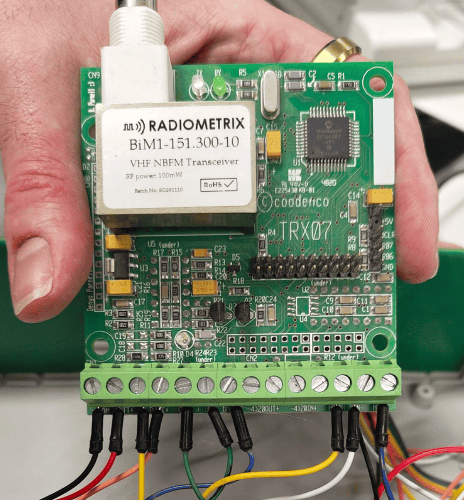
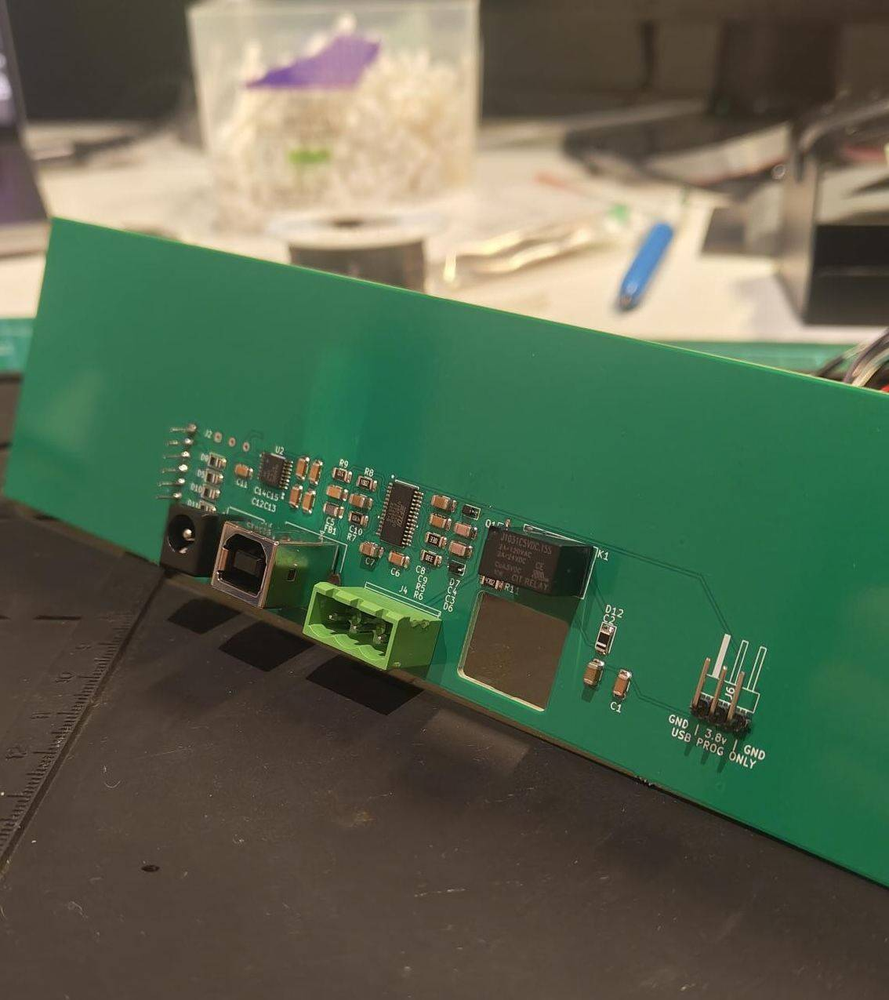
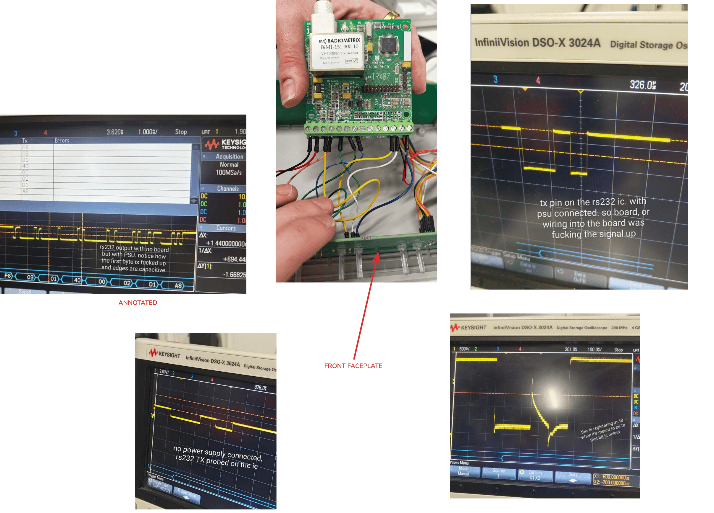

## Overview

Back in the old days (1980s), computers used to run 12V RS-232 serial ports with the classic DB connectors to communicate with peripherals. Not anymore. Most modern computers use some form of USB, and modern serial connections usually use some form of virtual COM port with TTL UART (this is what Arduinos use).

However, a large amount of farming electronics from this era still work, and are still used. But the modern computers they talk to do not support the old RS-232 connectors.

In 2024 I was commissioned to build an enclosure and an IO shield for one of these old farming boards (Aquator) that used this old protocol. I could have bought a simple RS-232 to USB adaptor and shipped it with the shield, but I decided to put the actual electronics into the board.

The Aquator board

 

This is bread and butter for most electronics projects, but this was my second PCB and it was my first time working with an IC besides the ESP32-WROOM.

I originally created a board that used a HID IC, instead of a UART IC. It was a strong lesson in patience, and reading the datasheet. Perhaps a lesson people won't learn anymore after AI starts doing component selection.

The first PCB. I used 0805 components to make DIY assembly easier and I was initially going to make the PCB footprint as small as possible and use a plastic faceplate for the enclosure. But I ended up using the actual PCB as the faceplate. Hence the crammed electronics and the huge board.

 

Before I figured out I had the wrong USB IC, and the PCB basically appeared as a keyboard on the computer, I couldn't get the computer to even register it at all!
I learnt a lot about USB and PCB debugging in general while I was trying to figure out why the device would not appear in the device manager. That was until I checked my 5V rail, which sat around half of what it was meant to be. Curious, I suspected a botched solder or some sort of component selection issue. But to my surprise (as an avid DRC checker) the issue was a lot more simple.

That is a direct short to ground. Somehow I placed a GND via straight through the main power line.

Since this first revision, I have changed the IC, fixed the short and been able to send commands to the board.
The commands made it to the shield board, but were jumbled up before they made it from there to the actual Aquator device.

I had routed the PCB poorly, failed to implement signal integrity principles and used overly long DuPonts like it was an Arduino project. Although, you can see that when the Aquator is not connected, the signal is fine. Perhaps my only Aquator board was broken. It needs another revision with an actual RS-232 test device to connect with for debugging, but I put it to sleep shortly before my internship in 2025, and it has stayed there since.

I shall update this project if I come back to it.
