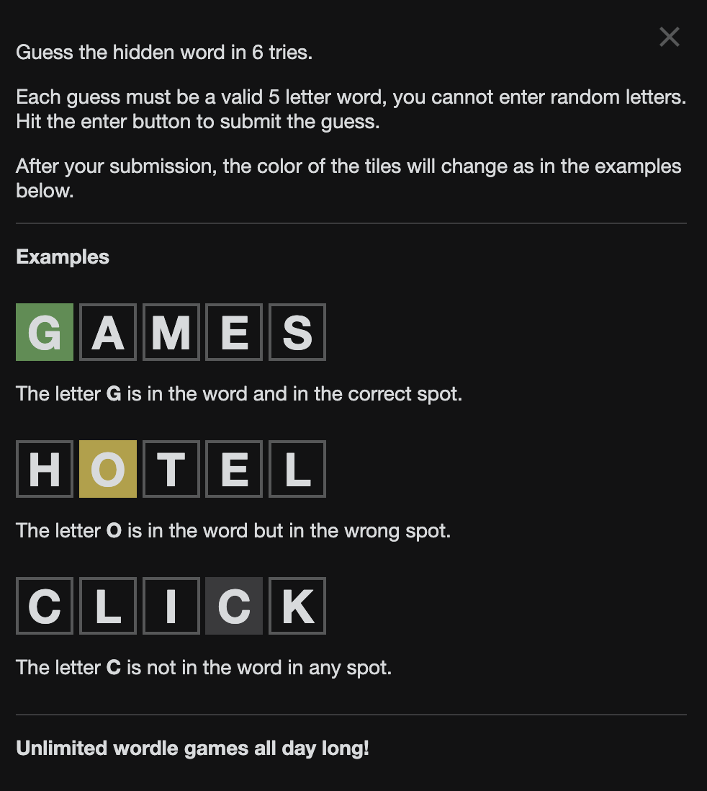
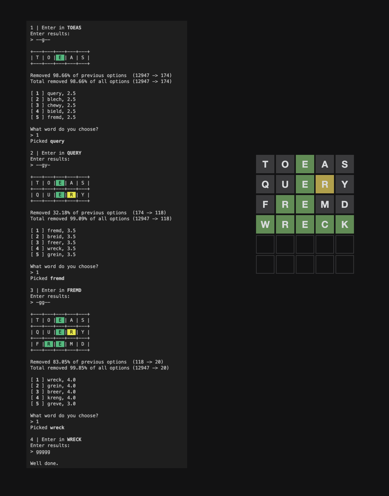

## Introduction

On a random weekend in the midst of year 12 when [Wordle](https://www.nytimes.com/games/wordle/index.html) was at its peak and I was studying VCE Algorithmics, I decided to try and solve the Wordle using a brute force algorithm.

For those that don't play, here are the instructions.



<br>

And here is how a game of Wordle looks when solved with my tool.

<br>



This project is on [GitHub](https://github.com/mcloughlan/Wordle-Solver)

## Algorithm

The design was based on the simple intuition of a regular player. Think of all the words that the answer could possibly be based on the letters remaining in the keyboard, and pick words that match the yellows and greens you have revealed on the board.

The algorithm implemented this almost exactly. As you play it would score each possible answer from a list of `12947` words giving high scores to multiple matches of green or yellow and an additional point boost if the word was 'popular' and doesn't have duplicate letters.

```python
def get_score(word, assumptions) -> list:
    """
    Score the word based on:
    - Has green letter -> += 1.5
    - Has yellow letter -> += 1
    - Is popular += 0.5
    - No duplicate letters += 1

    Assumptions -> Each letter in form of: [[may be], [is not]] or when definite: "letter" -> "a"
    """
    score = 0.0
    for letter, ass in zip(word, assumptions):
        if isinstance(ass, str):
            if letter == ass:
                # This has already been figured out. This letter is fine
                # NOTE this can be changed back to a 2, 1 was for testing
                score += 1.5
                continue
            else:
                # There is no way this word is valid
                return -1
        elif letter in ass[0]:
            # Letter has been spotted as a yellow match
            score += 1
        if letter in ass[1]:
            # Letter has been explicitly proved impossible in this spot
            return -1
    if len(set(word)) == len(word):
        # No duplicates
        score += 1
    if word[0] in POPULAR:
        # Word is commonly used
        score += 0.5
    return [word, score]
```

The solver would then rank each valid answer for you to attempt in order of descending score with the top 5 most optimal responses available for the user to select.

### Picking An Optimal Starting Word

Everyone has a different starting word they like. But what is the best starting word? Well back when I made this, I figured `toeas` had the most potential.

I ran a basic test where I iterated over every single valid Wordle word as the first guess in a Wordle game and the algorithm would assign it a fake match of `yggy-` and then rank the next word choice based on how many words it would invalidate. The test settled on `toeas` as it removed the most words. The example in [the introduction](#introduction) removed 98.66% of possible answers.

As I am writing this in 2026, I figured that that method was horrible and there was a simple way to redo this test much more effectively. So a second test was run where each input word was matched against **every** possible answer with the algorithm picking the highest scoring response each time. I.e. play every single game possible. Then I found that this whole algorithm sucked a lot and that the most optimal starting word was actually `clipt` with a win rate of 89.86%. However, `toeas` still remained the most potent starting word based on percentage of possible answers removed (91.3% versus 84.7% for `pints`). So if you strictly play by the algorithm, `clipt` is optimal. But if you deviate a bit, `toeas` might still be the best start.

### Limitations

The scope of this project as small, and I identified a lot of limitations and room for improvement.

- Relevance of letters in guess
  - Guesses gives you suggestions with rare letters like x & y, rather than prioritising vowels and common letters
    - This is why you pick from 'top 5'
- Not playing on hard mode
  - The guesses adhere to hard mode, all previous hints must be used in next answer
  - This means the script can have trouble gaining yellow letters if the board is mostly discovered
- Optimisations
  - This is mostly brute force. A more efficient method may be beneficial such as a probabilistic model to prioritise the testing of more optimal letters.
- Doesn't explicitly rule out the definite spots of yellow letters when you have ruled out the spots it's not in - See [#1](https://github.com/Sandwich1699975/Wordle-Solver/issues/1)

## Conclusion

Overall I recall this being a fun project. It was a good way to dissect a problem with my developing algorithmic mentality and find the true benefit in optimisation techniques.
